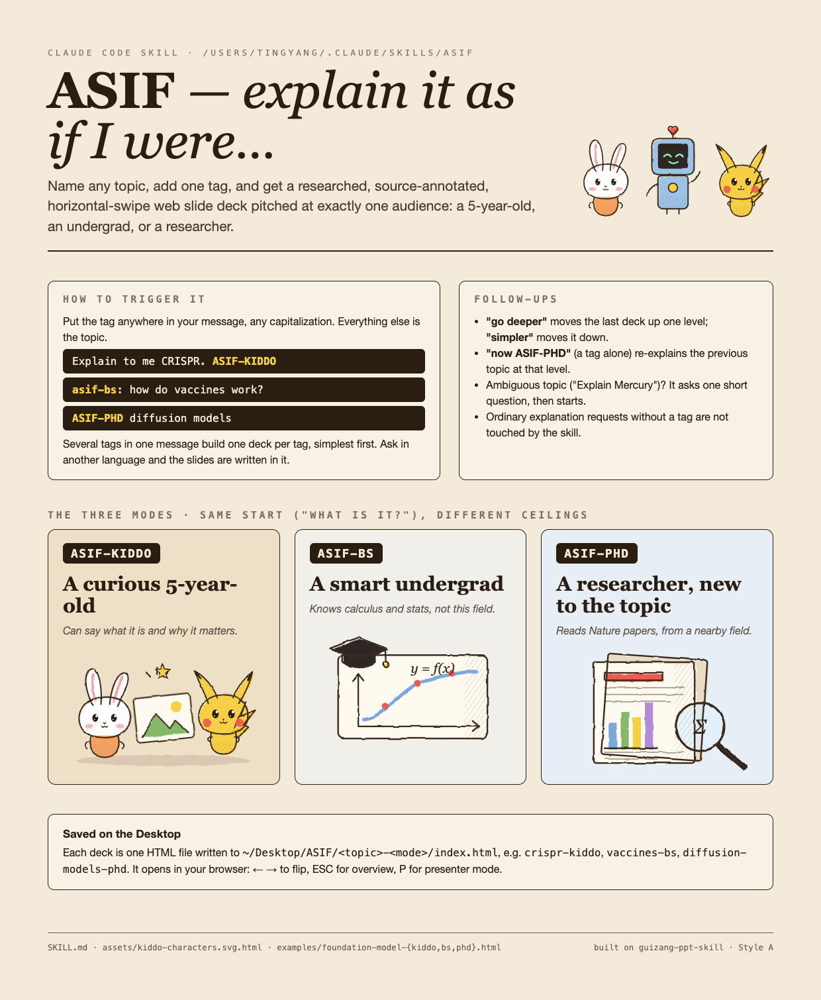

<p align="center">
  
</p>

<h1 align="center">ASIF</h1>
<p align="center"><em>Explain it <b>as if</b> I were a 5-year-old, an undergrad, or a PhD.</em></p>
<p align="center">
  <a href="https://tina04021997.github.io/asif-skill/">Live gallery</a> ·
  <a href="SKILL.md">SKILL.md</a> ·
  <a href="#install">Install</a> ·
  <a href="#gallery">Decks</a>
</p>

A [Claude Code](https://claude.com/claude-code) skill. Name any topic, add one tag, and get a researched, source-annotated, horizontal-swipe web slide deck pitched at exactly one audience.

```text
Explain to me CRISPR. ASIF-KIDDO
asif-bs: how do vaccines work?
ASIF-PHD diffusion models
```

Each deck is a single self-contained HTML file. Open it in a browser: `←` `→` to flip, `Esc` for the overview, `P` for presenter mode.

## The three modes

| Tag | Audience | Slides | Where the ramp ends | Look |
|---|---|---|---|---|
| `ASIF-KIDDO` | A curious 5-year-old | 5–6 | The gist: what it is and why it matters, in their own words | Hand-drawn pencil cartoons on kraft paper |
| `ASIF-BS` | A smart undergrad with no background in this field | 7–9 | How it works, with every formula introduced in words and every symbol defined | Ink Classic magazine |
| `ASIF-PHD` | A researcher who reads this field's Nature papers, but is new to the topic | ≤10 | The research frontier: formal model, landmark papers, open problems | Indigo Porcelain |

The three levels are not the same content at three lengths. They all start at the same place, *what is it, what does it look like in the real world, what problem does it solve*, and differ in how far and how fast they climb.

## What every deck gets

- **Research from legitimate sources.** Peer-reviewed papers, reference works, official bodies, and outlets with editorial standards. Wikipedia is for orientation only; the deck cites what Wikipedia cites. Nothing is invented, and uncertain claims are labelled as such.
- **A source line on every slide** that uses published material, with a clickable link (DOI preferred). Undergrad and PhD decks end with a References slide.
- **Orientation before formalism.** Early decks dove into equations before saying what the thing was. The skill now requires a plain-language "What is it?" slide before any mechanism, at every level.
- **PhD mode finds the most-cited papers** through the [OpenAlex](https://openalex.org) API (Semantic Scholar as a cross-check), reports citation counts with date and source, and adds a "Go further" slide with key papers, repos, datasets and venues.
- **Original illustrations only.** Diagrams and cartoons are inline SVG drawn for the deck. Kiddo decks use a pencil-sketch character kit in [`assets/kiddo-characters.svg.html`](assets/kiddo-characters.svg.html): a wobbly-line filter, pencil hatching, and chibi characters that *evoke* Miffy and Pokémon without copying official artwork.
- **A visual self-check.** Slides are screenshotted with headless Chrome and inspected for overflow and unreadable formulas before hand-off.

## Follow-ups

| You say | ASIF does |
|---|---|
| `go deeper` / `simpler` | Rebuilds the last topic one level up or down |
| `now ASIF-PHD` (a tag alone) | Reuses the previous topic at that level |
| Several tags in one message | One deck per tag, simplest first |
| A message in another language | Slides written in that language |
| An ambiguous topic ("Explain Mercury") | One short clarifying question, then it starts |

Ordinary explanation requests without a tag are not touched by the skill.

## Gallery

Every deck below was produced by the skill as-is. Live links are served from this repo through GitHub Pages.

| Deck | Mode | Slides | Live | Source |
|---|---|---|---|---|
| What is a Foundation Model? | Kiddo | 6 | [open](https://tina04021997.github.io/asif-skill/examples/foundation-model-kiddo.html) | [`examples/foundation-model-kiddo.html`](examples/foundation-model-kiddo.html) |
| Foundation Models | Undergrad | 9 | [open](https://tina04021997.github.io/asif-skill/examples/foundation-model-bs.html) | [`examples/foundation-model-bs.html`](examples/foundation-model-bs.html) |
| Foundation Models | PhD | 10 | [open](https://tina04021997.github.io/asif-skill/examples/foundation-model-phd.html) | [`examples/foundation-model-phd.html`](examples/foundation-model-phd.html) |
| What is a GPU? | Kiddo | 6 | [open](https://tina04021997.github.io/asif-skill/gallery/gpu-kiddo.html) | [`gallery/gpu-kiddo.html`](gallery/gpu-kiddo.html) |
| What is Machine Learning? | Kiddo | 6 | [open](https://tina04021997.github.io/asif-skill/gallery/machine-learning-kiddo.html) | [`gallery/machine-learning-kiddo.html`](gallery/machine-learning-kiddo.html) |
| What is Optogenetics? | Kiddo | 6 | [open](https://tina04021997.github.io/asif-skill/gallery/optogenetics-kiddo.html) | [`gallery/optogenetics-kiddo.html`](gallery/optogenetics-kiddo.html) |

The three foundation-model decks are the reference decks that `SKILL.md` points Claude at for tone, density and structure. The same topic at three levels is the quickest way to see what the modes do differently.

There is also a one-page poster introducing the skill: [HTML](https://tina04021997.github.io/asif-skill/docs/asif-intro.html) · [PNG](docs/asif-intro.png) · [PDF](docs/asif-intro.pdf).

## Install

ASIF builds its decks with [guizang-ppt-skill](https://github.com/op7418/guizang-ppt-skill) (Style A, "电子杂志 × 电子墨水"), so install that first. Both go in your Claude Code skills folder.

```bash
# 1. The deck engine ASIF builds on
git clone https://github.com/op7418/guizang-ppt-skill ~/.claude/skills/guizang-ppt-skill

# 2. ASIF itself
git clone https://github.com/Tina04021997/asif-skill ~/.claude/skills/asif
```

Then, in Claude Code:

```text
Explain photosynthesis. ASIF-KIDDO
```

Decks are written to `~/Desktop/ASIF/<topic>-<mode>/index.html` and opened in your browser. To change the output folder, edit the **Output location** line in [`SKILL.md`](SKILL.md) §5.

Formulas in Undergrad and PhD decks are rendered with KaTeX from a CDN, and icons come from Lucide, so a deck needs an internet connection the first time it is opened.

## How it works

`SKILL.md` is the whole skill. It walks Claude through six steps:

1. **Parse** the tag, the topic, the language, and any follow-up ("go deeper").
2. **Research** from acceptable sources with WebSearch and WebFetch, keeping a running claim → source list. PhD mode also queries OpenAlex for the most-cited papers, with notes on the API's quirks learned from earlier runs.
3. **Write to the level.** Per-mode rules for vocabulary, arc, slide count, use of formulas, and illustration style, each anchored to a reference deck in `examples/`.
4. **Annotate sources** on every slide.
5. **Build** with guizang Style A, picking the theme by mode (Kraft Paper, Ink Classic, Indigo Porcelain), adding KaTeX when needed, and running a screenshot self-check.
6. **Hand off** with the path, slide count, one line per slide, and (PhD) the papers chosen with their citation counts.

## Repo layout

```text
asif-skill/
├── SKILL.md                        The skill. Clone the repo into ~/.claude/skills/asif and this is picked up.
├── assets/
│   └── kiddo-characters.svg.html   Pencil-sketch SVG kit: filters, hatching, Bunny, Zappy, Bo, books, picture.
├── examples/                       Reference decks cited by SKILL.md (one topic, three levels).
├── gallery/                        More finished decks.
├── docs/                           One-page intro poster (HTML, PNG, PDF).
└── index.html                      Landing page for GitHub Pages, linking to every deck.
```

## Customizing

- **Characters.** Add a `<symbol>` to `assets/kiddo-characters.svg.html` following the recipe in `SKILL.md` §3 (offset crayon fills under `filter="url(#sketch2)"`, then a `var(--line)` outline under `filter="url(#sketch)"`).
- **Levels.** Each mode is a self-contained section in `SKILL.md` §3. Adjusting a slide budget or an arc is a one-line edit.
- **Themes.** The mode → theme mapping is the table in `SKILL.md` §5; any theme from guizang's `references/themes.md` works.

## Credits and license

- The skill, the character kit, the poster and this README are released under the [MIT License](LICENSE).
- Decks are generated from the Style A template of [guizang-ppt-skill](https://github.com/op7418/guizang-ppt-skill) by [op7418](https://github.com/op7418), which is licensed AGPL-3.0. The HTML files in `examples/` and `gallery/` embed that template's runtime (navigation, presenter mode, backgrounds) and are shared under AGPL-3.0 accordingly. guizang-ppt-skill is not vendored here; install it separately.
- Character drawings are original and only evoke Miffy (Dick Bruna / Mercis) and Pokémon (Nintendo / The Pokémon Company). No official artwork is used.
